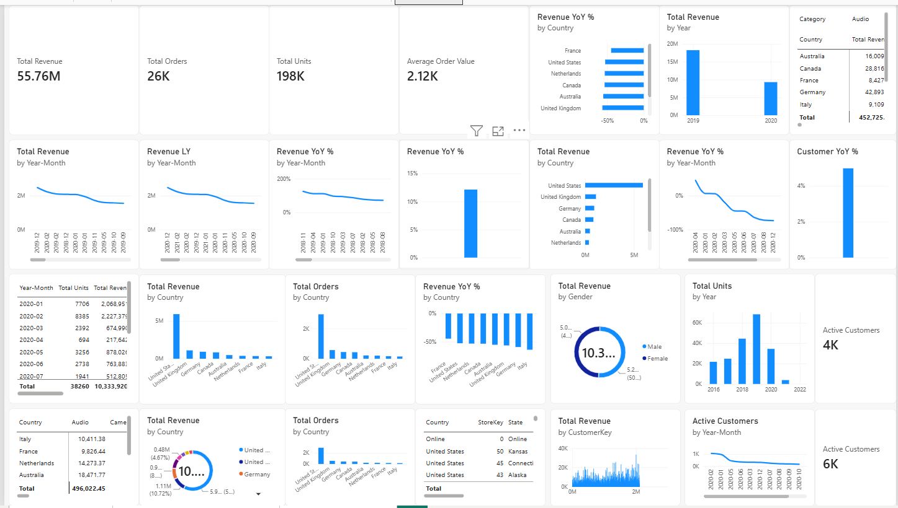
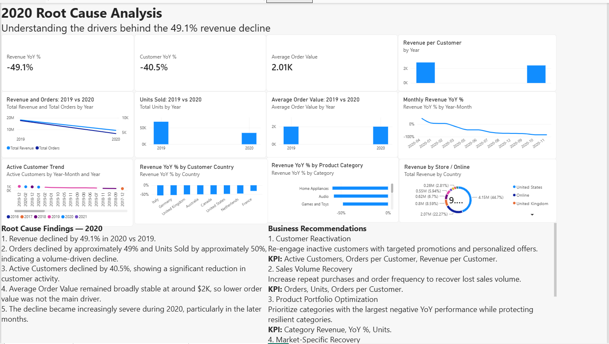
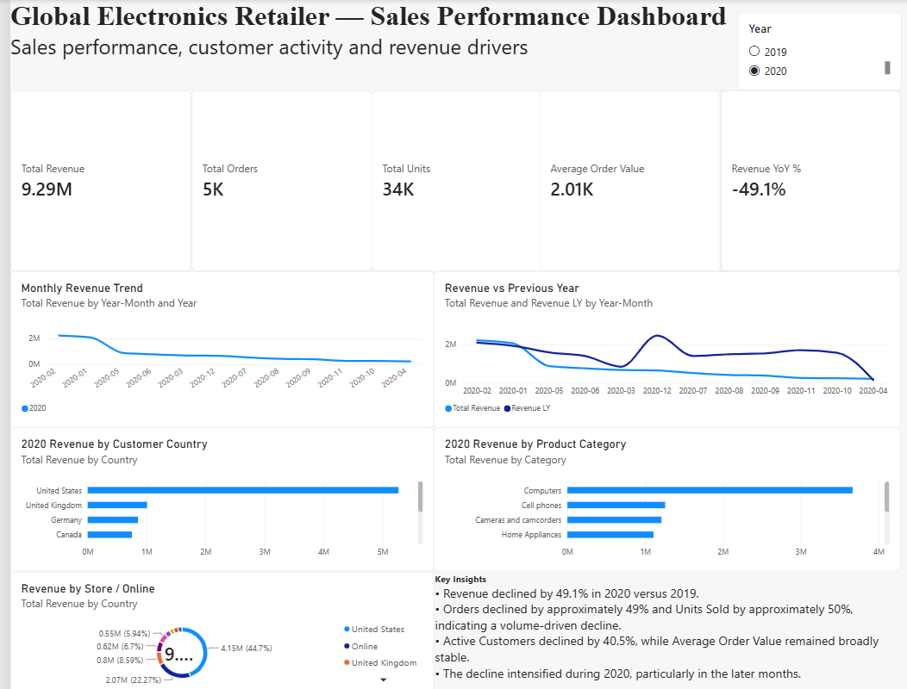

# Global Electronics — Sotuvlar tahlili

# Global Electronics — Sotuvlar tahlili (Power BI)

Global Electronics chakana savdo kompaniyasining sotuvlari, mijozlar faolligi
va daromad omillarini Power BI'da tahlil qilish loyihasi. Asosiy savol:
**2020-yilda daromad nega 49.1% ga tushib ketdi?**

## Dashboard (3 sahifa)

### 1. Executive Dashboard
Rahbariyat uchun umumiy ko'rinish: asosiy KPI'lar, oylik daromad dinamikasi,
o'tgan yil bilan taqqoslash, davlat va mahsulot toifasi bo'yicha daromad.

### 2. Root Cause & Recommendations
Daromad pasayishining sabablari va biznes tavsiyalar.

### 3. Detailed Analysis
Davlat, yil, jins va do'konlar kesimida batafsil tahlil.

## Asosiy ko'rsatkichlar

| Ko'rsatkich | Barcha davr | 2020 |
|---|---|---|
| Umumiy daromad | 55.76M | 9.29M |
| Buyurtmalar soni | 26K | 5K |
| Sotilgan birliklar | 198K | 34K |
| O'rtacha buyurtma qiymati | 2.12K | 2.01K |

## Asosiy topilmalar

1. 2020-yilda daromad 2019-ga nisbatan **49.1%** kamaygan.
2. Buyurtmalar ~49%, sotilgan birliklar ~50% kamaygan, ya'ni pasayish hajm bilan bog'liq.
3. Faol mijozlar **40.5%** kamaygan.
4. O'rtacha buyurtma qiymati ~2K atrofida barqaror qolgan, demak muammo narxda emas.
5. Pasayish 2020-yilning ikkinchi yarmida kuchaygan.
6. Daromadning asosiy qismi AQSh'dan; yetakchi toifa — Computers.

## Biznes tavsiyalar

1. **Mijozlarni qaytarish** — nofaol mijozlarga maqsadli aksiyalar. KPI: faol mijozlar, mijozga to'g'ri keladigan buyurtmalar.
2. **Sotuv hajmini tiklash** — takroriy xaridlarni oshirish. KPI: buyurtmalar, birliklar.
3. **Mahsulot portfeli** — eng ko'p pasaygan toifalarga e'tibor, barqaror toifalarni himoya qilish.
4. **Bozorlar bo'yicha tiklash** — davlatlar kesimida alohida reja.

## Fayllar

- `Global_Electronics_Sales_Analysis.pbix` — Power BI loyiha fayli (ochish uchun Power BI Desktop kerak)
- `images/` — dashboard skrinshotlari

## Vositalar

Power BI (DAX o'lchovlar, YoY hisob-kitoblar, vizualizatsiya)

## Muallif

Abdulxamid Abrorov